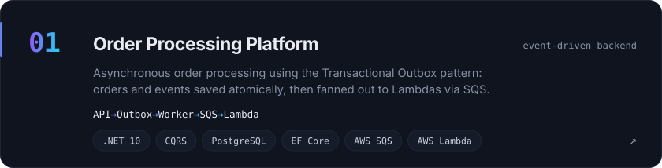
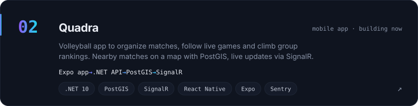
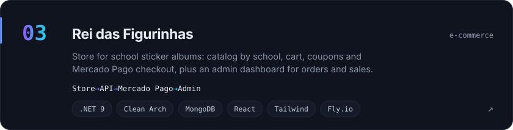
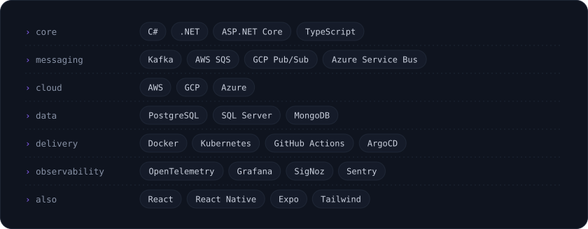

<picture>
  <source media="(prefers-color-scheme: dark)" srcset="./assets/header-dark.svg" />
  <source media="(prefers-color-scheme: light)" srcset="./assets/header-light.svg" />
  
</picture>

 

I build the parts of a product nobody sees but everyone depends on: APIs, queues, workers and the observability that keeps them honest. **5+ years** with **.NET / C#**, shipping event-driven systems across AWS, GCP and Azure, with a bias for performance, cost and code that stays readable a year later.

Currently building **Quadra**, a volleyball app, and doing a postgrad in **Applied AI Engineering** (UNIPDS / Anhanguera).

 

### Selected work

<a href="https://github.com/RenanOrtega/order-processing-platform">
  <picture>
    <source media="(prefers-color-scheme: dark)" srcset="./assets/project-order-processing-dark.svg" />
    <source media="(prefers-color-scheme: light)" srcset="./assets/project-order-processing-light.svg" />
    
  </picture>
</a>

<a href="https://github.com/quadra-volei/quadra-api">
  <picture>
    <source media="(prefers-color-scheme: dark)" srcset="./assets/project-quadra-dark.svg" />
    <source media="(prefers-color-scheme: light)" srcset="./assets/project-quadra-light.svg" />
    
  </picture>
</a>

<a href="https://github.com/quadra-volei/quadra-api">api</a> · <a href="https://github.com/quadra-volei/quadra-mobile">mobile</a>

<a href="https://github.com/RenanOrtega/champions-chromo-backend">
  <picture>
    <source media="(prefers-color-scheme: dark)" srcset="./assets/project-rei-das-figurinhas-dark.svg" />
    <source media="(prefers-color-scheme: light)" srcset="./assets/project-rei-das-figurinhas-light.svg" />
    
  </picture>
</a>

<a href="https://github.com/RenanOrtega/champions-chromo-backend">backend</a> · <a href="https://github.com/RenanOrtega/champions-chromo-frontend">store</a> · <a href="https://github.com/RenanOrtega/champions-chromo-admin">admin</a>

### Stack

<picture>
  <source media="(prefers-color-scheme: dark)" srcset="./assets/stack-dark.svg" />
  <source media="(prefers-color-scheme: light)" srcset="./assets/stack-light.svg" />
  
</picture>

 

  <a href="https://renanortega.com"><b>renanortega.com</b></a>
  &nbsp;·&nbsp;
  <a href="https://www.linkedin.com/in/renan-ortega/"><b>LinkedIn</b></a>
  &nbsp;·&nbsp;
  <a href="mailto:renanortega.dev@gmail.com"><b>renanortega.dev@gmail.com</b></a>

